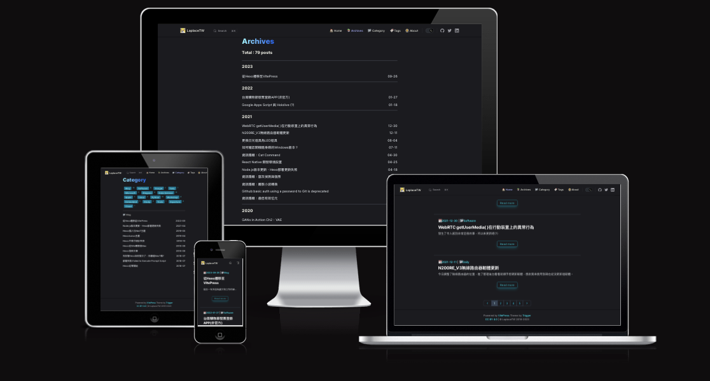

# vuemo-theme-trigger


Trigger is a blog theme for [Vuemo](https://github.com/laplacetw/vuemo), the blog framework built on [VitePress](https://vitepress.dev). It is named after the anime "World Trigger" and styled with Tailwind CSS (compiled for you, nothing to install). It builds on VitePress's default theme for the nav bar, search and footer.

> **Status: 2.0 alpha.** Vuemo is under development; the theme works with `@vuemo/core` `^0.1.0-alpha.0`.



## Use it

```sh
npm create vuemo@alpha my-blog -- --theme vuemo-theme-trigger@alpha
```

or in an existing Vuemo blog:

```sh
pnpm add vuemo-theme-trigger
```

```ts
// .vitepress/config.ts
import { defineBlogConfig } from '@vuemo/core'

export default defineBlogConfig({
  title: 'Trigger !',
  theme: 'vuemo-theme-trigger',
  appearance: 'dark',
  postsPerPage: 5,
  nav: [
    { text: '🏠 Home', link: '/' },
    { text: '📚 Archives', link: '/archives' },
    { text: '📁 Category', link: '/category' },
    { text: '🔖 Tags', link: '/tags' },
    { text: '🙆 About', link: '/about' }
  ],
  search: true,
  lastUpdated: true,
  themeConfig: { about: { avatar: '/avatar.png', quote: 'Trigger your blog !' } }
})
```

Create the pages the nav points to, each with a layout in its frontmatter:

| File | Frontmatter | Body |
| --- | --- | --- |
| `index.md` | `layout: home` | |
| `archives.md` | `layout: archive` | |
| `tags.md` | `layout: tag` | |
| `category.md` | `layout: category` | |
| `about.md` | `layout: page` | `<About />` |

`npm create vuemo@alpha my-blog -- --theme vuemo-theme-trigger` already creates these files, but its `about.md` only holds placeholder text. To get Trigger's About card (avatar and quote), put `<About />` in the body and set `themeConfig.about` in `.vitepress/config.ts`:

```md
---
title: About
layout: page
---

<About />

Any other Markdown you write here is rendered under the card.
```

See [`example/`](./example) for a complete blog. Posts go in `posts/`; an excerpt is the part before a `---` line.

## What it supports

| Vuemo option | In Trigger |
| --- | --- |
| `nav`, `logo`, `socialLinks`, `footer`, `search`, `lastUpdated` | shown by VitePress's default theme parts |
| `postsPerPage`, `summary` | home page list: excerpt (or description) and "Read more", paginated with `?page=` |
| `paths` | tag and category links (`?tag=`, `?category=`) |
| `comments`, `aiSummary` | the official plugins, in the standard post slots |
| `markdown` (`math`, `lineNumbers`, `config`) | VitePress / markdown-it; the example turns on math, line numbers and footnotes |

### Theme options (`themeConfig`)

| Option | Type | Meaning |
| --- | --- | --- |
| `about.avatar` | `string` | avatar of the About page: a file in `public/` or a URL (none by default) |
| `about.quote` | `string` | the line under it (default `Trigger your blog !`) |

The type `TriggerThemeConfig` is exported; a wrong value prints a `console.warn('[vuemo-theme-trigger] ...')`.

## Migrating from 1.x

Trigger 1.x was a repository you cloned and edited. 2.0 is a package; your posts stay as they are.

| 1.x | 2.0 |
| --- | --- |
| clone this repo | `pnpm add vuemo-theme-trigger` in a Vuemo blog (`npm create vuemo`) |
| `.vitepress/theme/config.ts` | `defineBlogConfig` in `.vitepress/config.ts` |
| `title`, `description`, `lang`, `base`, `appearance`, `cleanUrls`, `cacheDir`, `hostname` | the same names in `defineBlogConfig` (`hostname` also drives sitemap, RSS and JSON-LD) |
| `favicon` | `head: [['link', { rel: 'icon', href: '/favicon.png' }]]` |
| `logo`, `nav`, `socialLinks`, `footer`, `postsPerPage` | the same names in `defineBlogConfig` |
| `lastUpdated: true` | `lastUpdated: true` |
| `mdMath`, `mdLineNums` | `markdown: { math: true, lineNumbers: true }` |
| `markdown-it-footnote` set up in `config.ts` | `markdown: { config: (md) => md.use(footnote) }` (install `markdown-it-footnote`) |
| `utterances: { repo, issueTerm, light, dark }` | `comments: { provider: 'utterances', repo, ... }` ([`@vuemo/plugin-comments`](https://github.com/laplacetw/vuemo)); dark mode follows automatically |
| `cloudflareApi` | `aiSummary: { api: '<worker url>' }` ([`@vuemo/plugin-ai-summary`](https://github.com/laplacetw/vuemo)) |
| local search in `config.ts` | `search: true` |
| hard-coded About avatar and quote | `themeConfig.about { avatar, quote }` |
| `archives.md`: `<Archives />`, `tags.md`: `<Tags />`, `category.md`: `<Category />` | `layout: archive`, `layout: tag`, `layout: category` in the frontmatter, no body |
| `index.md`: `layout: home` | unchanged |
| posts in `posts/` | unchanged; `date`, `title`, `category`, `tags`, `description` (frontmatter schema of Vuemo) |
| `npm run new <name>` | `npx vuemo new <name>` |
| client-side JSON-LD | emitted at build time by Vuemo core (with `dateModified`) |
| pagination and tag/category state in a store (History API) | `?page=`, `?tag=`, `?category=` in the URL, so they can be linked and survive reloads |
| `.vitepress/theme/index.ts` with the theme code | the fixed one-liner `export { default } from '@vuemo/core/theme'` |
| Tailwind installed in your project | compiled into the theme (`dist/style.css`); nothing to install |
| `README_CH.md`, the Pages workflow | removed; use Vuemo's deployment guide |

## Develop the theme

```sh
pnpm install
pnpm build          # compile src/style.css to dist/style.css (Tailwind CSS v4)
pnpm dev            # the example blog
pnpm check          # vuemo check-theme: the theme contract
pnpm test
pnpm build:example
```

`@vuemo/core` and the two plugins come from npm (`devDependencies`). To develop against a local checkout of the Vuemo monorepo instead, temporarily point them at it with `link:../vuemo/packages/core`, `link:../vuemo/plugins/comments` and `link:../vuemo/plugins/ai-summary` (the monorepo must be built) and do not commit that change.

The GitHub Pages workflow (`.github/workflows/pages.yml`) builds the example blog on every push to `main`.

`pnpm typecheck` runs `vue-tsc`.

## License

MIT
