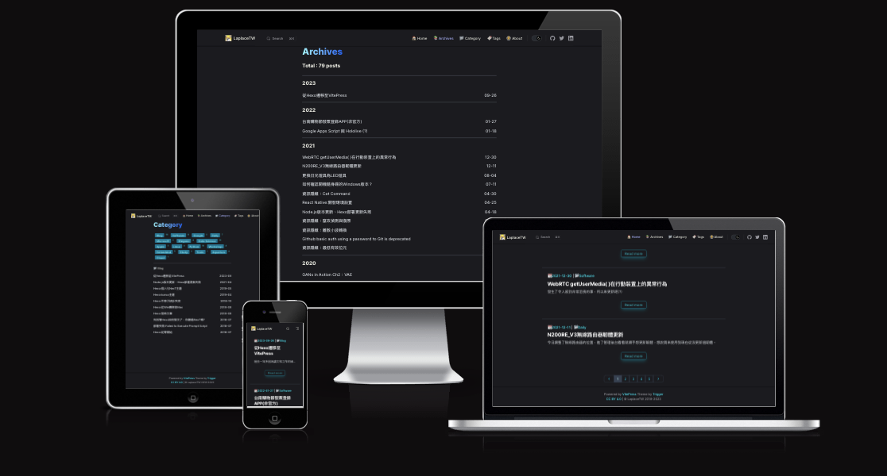
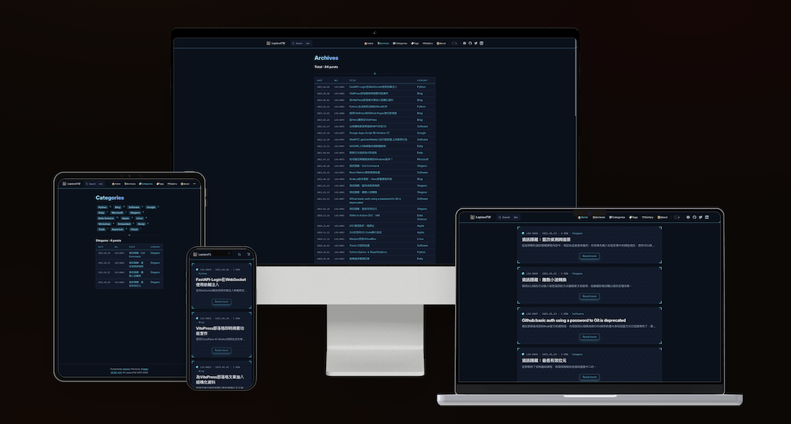

# vuemo-theme-trigger

**English** · [繁體中文](./README.zh-TW.md) · [简体中文](./README.zh-CN.md)


Trigger is a blog theme for [Vuemo](https://github.com/laplacetw/vuemo), the blog framework built on [VitePress](https://vitepress.dev). It has two looks: `normal`, the clean look of Trigger 1.x, and `anime`, an anime-inspired look. Tailwind CSS is compiled in, so there is nothing extra to install.

> **2.0 alpha.** Needs `@vuemo/core` 0.1.0-alpha.2 or later.





## Quick start

A new blog with Trigger:

```sh
npm create vuemo@alpha my-blog -- --theme trigger
cd my-blog
npm install
npm run dev
```

An existing Vuemo blog:

```sh
npm install vuemo-theme-trigger@alpha
```

```ts
// vuemo.config.ts
export default defineBlogConfig({
  theme: 'trigger',
  themeConfig: {
    style: 'anime',   // or 'normal' (default)
    about: { avatar: '/avatar.png', quote: 'Trigger your blog !' }
  }
})
```

No npm? Download `vuemo-theme-trigger-<version>.zip` from [Releases](https://github.com/laplacetw/vuemo-theme-trigger/releases), unzip it to `themes/trigger/` in your blog and set `theme: 'trigger'`. A folder in `themes/` wins over an installed package.

## Pages

Each page picks its layout in the frontmatter. `create-vuemo` writes these for you:

| File | Frontmatter |
| --- | --- |
| `index.md` | `layout: home` |
| `archives.md` | `layout: archive` |
| `tags.md` | `layout: tag` |
| `categories.md` | `layout: category` |
| `about.md` | `layout: about` (the card with avatar and quote, then your text) |

Posts go in `posts/`. The part before a `---` line is the excerpt on the home page. See [`example/`](./example) for a complete blog.

## Options

Theme options go in `themeConfig`:

| Option | Type | Default | Meaning |
| --- | --- | --- | --- |
| `style` | `'normal'` \| `'anime'` | `'normal'` | the look |
| `flavor` | `boolean` | `true` | `anime` only: `false` replaces the theme's words (`LOG-`, `緊急脫出`, `BRIEFING`) with plain ones (`No.`, `TOP`, `Contents`) |
| `about.avatar` | `string` | none | About page avatar: a file in `public/` or a URL |
| `about.quote` | `string` | `Trigger your blog !` | the line under the avatar |

A wrong value prints a `[vuemo-theme-trigger]` warning and falls back to the default. The type `TriggerThemeConfig` is exported.

Vuemo's own options all work: `nav`, `logo`, `socialLinks`, `footer`, `search` and `lastUpdated` (shown by VitePress's default theme parts), `postsPerPage` and `summary` (home page), `paths` (tag and category links), and the official plugins `comments`, `aiSummary` and `gallery`.

## The anime style

- graphite and navy surfaces with one signal-cyan accent, in light and dark mode
- a metadata line above post titles: `LOG-0042 · 2026.10.30 · 6 MIN · Category` (reading time needs `@vuemo/core` 0.1.0-alpha.3)
- on posts: a table of contents, a reading-progress line and a hexagon back-to-top button (`緊急` / `脫出`)
- archive, tag and category pages as a table (date, number, title, category)
- post cards with corner brackets, cube markers before metadata, frameless tag badges

It respects `prefers-reduced-motion`, and `pnpm test` checks WCAG contrast (text 4.5:1, borders and focus ring 3:1) in both styles. Colours are tokens in [`src/tokens.css`](./src/tokens.css), mapped to VitePress's variables, so VitePress's own search, buttons and tip blocks follow the accent.

## Photo gallery

[`@vuemo/plugin-gallery`](https://github.com/laplacetw/vuemo/blob/main/docs/gallery.md) works without extra code: enable `gallery` in `vuemo.config.ts` and add a `gallery.md` with `layout: page` and `<VuemoGallery />`. Trigger centres it and, in the `anime` style, maps its colours to the theme's tokens. Override any `--vuemo-gallery-*` CSS variable to change it.

## Migrating from 1.x

Trigger 1.x was a repository you cloned and edited. 2.0 is a package; your posts stay as they are.

| 1.x | 2.0 |
| --- | --- |
| clone this repo | `npm install vuemo-theme-trigger` in a Vuemo blog (`npm create vuemo`) |
| `.vitepress/theme/config.ts` | `defineBlogConfig` in `vuemo.config.ts` |
| `title`, `description`, `lang`, `base`, `appearance`, `cleanUrls`, `cacheDir`, `hostname` | the same names (`hostname` also drives sitemap, RSS and JSON-LD) |
| `logo`, `nav`, `socialLinks`, `footer`, `postsPerPage`, `lastUpdated` | the same names |
| `favicon` | `head: [['link', { rel: 'icon', href: '/favicon.png' }]]` |
| `mdMath`, `mdLineNums` | `markdown: { math: true, lineNumbers: true }` |
| `markdown-it-footnote` in `config.ts` | `markdown: { config: (md) => md.use(footnote) }` |
| `utterances: { repo, ... }` | `comments: { provider: 'utterances', repo, ... }`; dark mode follows automatically |
| `cloudflareApi` | `aiSummary: { api: '<worker url>' }` |
| local search in `config.ts` | `search: true` |
| hard-coded About avatar and quote | `themeConfig.about { avatar, quote }` |
| `<Archives />`, `<Tags />`, `<Category />` page bodies | `layout: archive`, `tag`, `category`, no body. With `@vuemo/core` 0.1.0-alpha.3 the category page is `categories.md`; `paths: { category: '/category' }` keeps `category.md` |
| `npm run new <name>` | `npx vuemo new <name>` |
| pagination and tag state in a store | `?page=`, `?tag=`, `?category=` in the URL |
| Tailwind in your project | compiled into the theme |

## Develop the theme

```sh
pnpm install
pnpm build          # src/style.css to dist/style.css (Tailwind CSS v4)
pnpm dev            # the example blog; STYLE=anime pnpm dev for the other look
pnpm check          # vuemo check-theme: the theme contract
pnpm test           # includes the colour snapshot and contrast checks
pnpm typecheck      # vue-tsc
pnpm package        # dist-zip/vuemo-theme-trigger-<version>.zip for the themes/ folder
```

`@vuemo/core` and the plugins come from npm. To develop against a local Vuemo checkout, temporarily point them at it with `link:../vuemo/packages/core` (and the plugins), and do not commit that change. Pushing a `v*` tag builds the zip and attaches it to a GitHub prerelease; every push to `main` deploys the example to GitHub Pages.

## Name and credits

The name is a nod to the manga *World Trigger* by Daisuke Ashihara. This is an unofficial fan-made project, not affiliated with or endorsed by the author, Shueisha or Toei Animation.

The theme contains no official artwork, logos, character likenesses or other material from that work. The `anime` style is inspired only by general motifs (a sci-fi control-room feel, HUD lines, hexagon geometry, a cool colour scheme) and a few general concepts as plain words (a log, a briefing, bailing out), all in [`src/flavor.ts`](./src/flavor.ts) and switched off with `flavor: false`. Every graphic is original work drawn in this repository under the MIT licence, listed in [ASSETS.md](./ASSETS.md); fonts are system fonts or OFL only. Contributions must follow the same rule (see the pull request template): nothing copied or traced from official material, no character names, and no other names or titles from the work in code, class names or documentation.

## License

MIT
