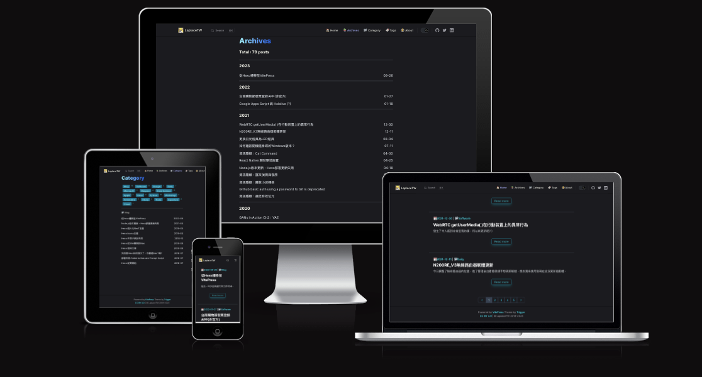
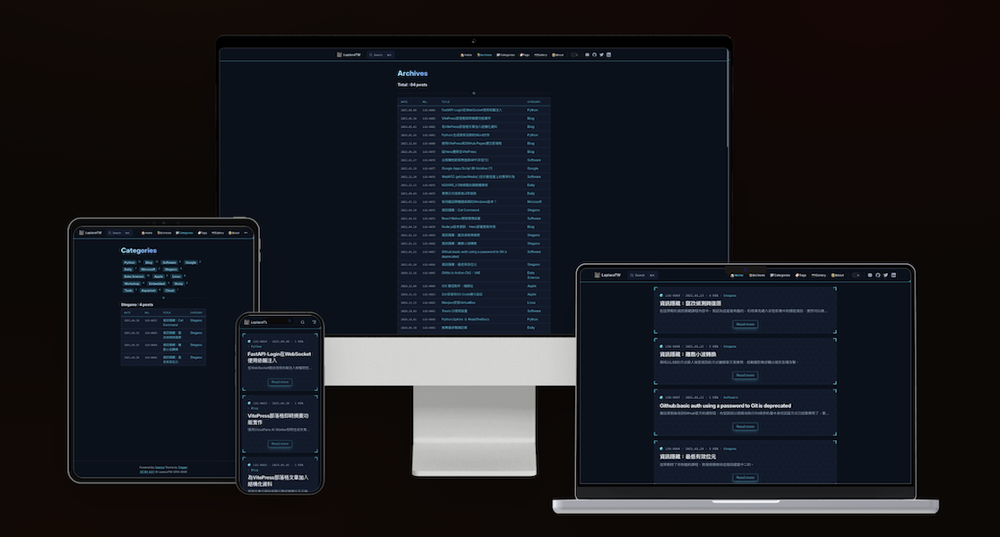

# vuemo-theme-trigger

[English](./README.md) · [繁體中文](./README.zh-TW.md) · **简体中文**


Trigger 是 [Vuemo](https://github.com/laplacetw/vuemo) 的博客主题，Vuemo 是基于 [VitePress](https://vitepress.dev) 的博客框架。主题有两种风格：`normal` 是 Trigger 1.x 的简洁风格，`anime` 是动漫风格。Tailwind CSS 已预先编译，无需另外安装。

> **2.0 alpha。** 需要 `@vuemo/core` 0.1.0-alpha.2 或更高版本。





## 快速开始

创建使用 Trigger 的新博客：

```sh
npm create vuemo@alpha my-blog -- --theme trigger
cd my-blog
npm install
npm run dev
```

已有 Vuemo 博客：

```sh
npm install vuemo-theme-trigger@alpha
```

```ts
// vuemo.config.ts
export default defineBlogConfig({
  theme: 'trigger',
  themeConfig: {
    style: 'anime',   // 或 'normal'（默认）
    about: { avatar: '/avatar.png', quote: 'Trigger your blog !' }
  }
})
```

不使用 npm：从 [Releases](https://github.com/laplacetw/vuemo-theme-trigger/releases) 下载 `vuemo-theme-trigger-<version>.zip`，解压到博客的 `themes/trigger/`，再设置 `theme: 'trigger'`。`themes/` 中的文件夹优先于已安装的包。

## 页面

每个页面在 frontmatter 中指定布局。`create-vuemo` 会自动创建以下文件：

| 文件 | Frontmatter |
| --- | --- |
| `index.md` | `layout: home` |
| `archives.md` | `layout: archive` |
| `tags.md` | `layout: tag` |
| `categories.md` | `layout: category` |
| `about.md` | `layout: about`（先显示头像和引言卡片，再显示你的正文） |

文章放在 `posts/`。`---` 分隔线之前的段落是首页显示的摘要。完整示例见 [`example/`](./example)。

## 配置项

主题配置写在 `themeConfig` 中：

| 配置项 | 类型 | 默认值 | 说明 |
| --- | --- | --- | --- |
| `style` | `'normal'` \| `'anime'` | `'normal'` | 风格 |
| `flavor` | `boolean` | `true` | 仅 `anime`：设为 `false` 时，主题用语（`LOG-`、`緊急脫出`、`BRIEFING`）改为普通用语（`No.`、`TOP`、`Contents`） |
| `about.avatar` | `string` | 无 | About 页的头像：`public/` 中的文件或 URL |
| `about.quote` | `string` | `Trigger your blog !` | 头像下方的文字 |

值不正确时，主题会输出 `[vuemo-theme-trigger]` 警告并使用默认值。主题导出类型 `TriggerThemeConfig`。

Vuemo 自身的配置项都可以使用：`nav`、`logo`、`socialLinks`、`footer`、`search` 和 `lastUpdated`（由 VitePress 默认主题的组件显示）、`postsPerPage` 和 `summary`（首页）、`paths`（标签和分类链接），以及官方插件 `comments`、`aiSummary` 和 `gallery`。

## anime 风格

- 石墨色和藏青色底色，搭配单一青色强调色，支持浅色和深色模式
- 文章标题上方的信息栏：`LOG-0042 · 2026.10.30 · 6 MIN · Category`（阅读时间需要 `@vuemo/core` 0.1.0-alpha.3）
- 文章页：目录、阅读进度条，以及六边形的回到顶部按钮（`緊急` / `脫出`）
- 归档、标签和分类页以表格显示（日期、编号、标题、分类）
- 文章卡片的角框、信息栏前的方块标记、无边框的标签

该风格遵循 `prefers-reduced-motion`。`pnpm test` 会检查两种风格的 WCAG 对比度（文字 4.5:1，边框和焦点框 3:1）。颜色定义为 [`src/tokens.css`](./src/tokens.css) 中的 token，并映射到 VitePress 的变量，因此 VitePress 的搜索、按钮和提示容器也会使用强调色。

## 相册

[`@vuemo/plugin-gallery`](https://github.com/laplacetw/vuemo/blob/main/docs/gallery.md) 无需额外代码：在 `vuemo.config.ts` 中启用 `gallery`，再添加 `gallery.md`，内容为 `layout: page` 和 `<VuemoGallery />`。Trigger 会将相册居中；`anime` 风格下，相册颜色会映射到主题的 token。如需调整，覆盖任意 `--vuemo-gallery-*` CSS 变量即可。

## 从 1.x 迁移

Trigger 1.x 需要 clone 仓库后直接修改；2.0 改为一个包，文章无需修改。配置对照表见[英文版](./README.md#migrating-from-1x)。

## 开发主题

```sh
pnpm install
pnpm build          # 将 src/style.css 编译为 dist/style.css（Tailwind CSS v4）
pnpm dev            # 示例博客；STYLE=anime pnpm dev 显示另一种风格
pnpm check          # vuemo check-theme：检查主题约定
pnpm test           # 包括颜色快照和对比度检查
pnpm typecheck      # vue-tsc
pnpm package        # 生成 dist-zip/vuemo-theme-trigger-<version>.zip，供 themes/ 文件夹使用
```

`@vuemo/core` 和插件从 npm 安装。如需基于本地的 Vuemo 源码开发，临时改用 `link:../vuemo/packages/core`（插件同理），并且不要提交这项修改。推送 `v*` 标签会构建 zip 并附加到 GitHub prerelease；每次推送到 `main` 都会把示例部署到 GitHub Pages。

## 名称与致谢

名称致敬苇原大介的漫画《World Trigger》。本项目是非官方的同人作品，与原作者、集英社及东映动画无关，也未获得其认可。

主题不包含原作的官方插图、标志、角色形象或其他素材。`anime` 风格只参考一般性的元素（科幻指挥室的氛围、HUD 线条、六边形几何、冷色调），以及几个以普通词汇表达的概念（记录、简报、紧急脱出）。这些词汇都在 [`src/flavor.ts`](./src/flavor.ts) 中，可以用 `flavor: false` 关闭。所有图形都是在本仓库中原创绘制，以 MIT 许可证发布，清单见 [ASSETS.md](./ASSETS.md)；字体只使用系统字体或 OFL 许可字体。贡献也须遵守相同规则（见 pull request 模板）：不得复制或描摹官方素材，代码、class 名称和文档中不得出现角色名称或原作的其他名称与标题。

## 许可证

MIT
