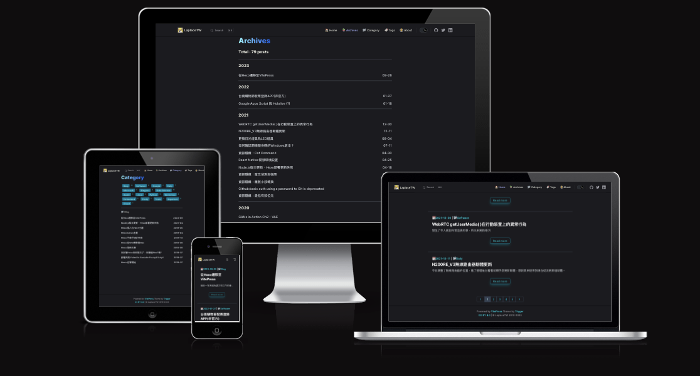

# vuemo-theme-trigger

[English](./README.md) · **繁體中文** · [简体中文](./README.zh-CN.md)

Trigger 是 [Vuemo](https://github.com/laplacetw/vuemo) 的部落格主題，Vuemo 是以 [VitePress](https://vitepress.dev) 為基礎的部落格框架。主題有兩種風格：`normal` 是 Trigger 1.x 的簡潔風格，`anime` 是作戰指揮台風格。Tailwind CSS 已預先編譯，不需要另外安裝。

> **2.0 alpha。** 需要 `@vuemo/core` 0.1.0-alpha.2 以上。



## 快速開始

建立使用 Trigger 的新部落格：

```sh
npm create vuemo@alpha my-blog -- --theme trigger
cd my-blog
npm install
npm run dev
```

已有 Vuemo 部落格：

```sh
npm install vuemo-theme-trigger@alpha
```

```ts
// vuemo.config.ts
export default defineBlogConfig({
  theme: 'trigger',
  themeConfig: {
    style: 'anime',   // 或 'normal'（預設）
    about: { avatar: '/avatar.png', quote: 'Trigger your blog !' }
  }
})
```

不使用 npm：從 [Releases](https://github.com/laplacetw/vuemo-theme-trigger/releases) 下載 `vuemo-theme-trigger-<version>.zip`，解壓縮到部落格的 `themes/trigger/`，再設定 `theme: 'trigger'`。`themes/` 裡的資料夾優先於已安裝的套件。

## 頁面

每個頁面在 frontmatter 指定版面。`create-vuemo` 會自動建立以下檔案：

| 檔案 | Frontmatter |
| --- | --- |
| `index.md` | `layout: home` |
| `archives.md` | `layout: archive` |
| `tags.md` | `layout: tag` |
| `categories.md` | `layout: category` |
| `about.md` | `layout: about`（先顯示頭像與引言卡片，再顯示你的內文） |

文章放在 `posts/`。`---` 分隔線之前的段落是首頁顯示的摘要。完整範例見 [`example/`](./example)。

## 選項

主題選項寫在 `themeConfig`：

| 選項 | 型別 | 預設值 | 說明 |
| --- | --- | --- | --- |
| `style` | `'normal'` \| `'anime'` | `'normal'` | 風格 |
| `flavor` | `boolean` | `true` | 僅 `anime`：設為 `false` 時，主題用語（`LOG-`、`緊急脫出`、`BRIEFING`）改為一般用語（`No.`、`TOP`、`Contents`） |
| `about.avatar` | `string` | 無 | About 頁的頭像：`public/` 中的檔案或 URL |
| `about.quote` | `string` | `Trigger your blog !` | 頭像下方的文字 |

值不正確時，主題會輸出 `[vuemo-theme-trigger]` 警告並改用預設值。主題匯出型別 `TriggerThemeConfig`。

Vuemo 本身的選項都能使用：`nav`、`logo`、`socialLinks`、`footer`、`search` 與 `lastUpdated`（由 VitePress 預設主題的元件顯示）、`postsPerPage` 與 `summary`（首頁）、`paths`（標籤與分類連結），以及官方外掛 `comments`、`aiSummary` 與 `gallery`。

## anime 風格

- 石墨色與藏青色底，搭配單一青色強調色，支援淺色與深色模式
- 文章標題上方的資訊列：`LOG-0042 · 2026.10.30 · 6 MIN · Category`（閱讀時間需要 `@vuemo/core` 0.1.0-alpha.3）
- 文章頁：目錄、閱讀進度線，以及六角形的回到頂端按鈕（`緊急` / `脫出`）
- 歸檔、標籤與分類頁以表格呈現（日期、編號、標題、分類）
- 文章卡片的角框、資訊列前的方塊標記、無外框的標籤

此風格遵循 `prefers-reduced-motion`。`pnpm test` 會檢查兩種風格的 WCAG 對比（文字 4.5:1，邊框與焦點框 3:1）。顏色定義為 [`src/tokens.css`](./src/tokens.css) 中的 token，並對應到 VitePress 的變數，因此 VitePress 的搜尋、按鈕與提示區塊也會使用強調色。

## 相簿

[`@vuemo/plugin-gallery`](https://github.com/laplacetw/vuemo/blob/main/docs/gallery.md) 不需要額外程式碼：在 `vuemo.config.ts` 啟用 `gallery`，再新增 `gallery.md`，內容為 `layout: page` 與 `<VuemoGallery />`。Trigger 會將相簿置中；`anime` 風格下，相簿顏色會對應到主題的 token。若要調整，覆寫任一 `--vuemo-gallery-*` CSS 變數即可。

## 從 1.x 遷移

Trigger 1.x 需要 clone repo 後直接修改；2.0 改為套件，文章不需要修改。設定對照表見[英文版](./README.md#migrating-from-1x)。

## 開發主題

```sh
pnpm install
pnpm build          # 將 src/style.css 編譯為 dist/style.css（Tailwind CSS v4）
pnpm dev            # 範例部落格；STYLE=anime pnpm dev 顯示另一種風格
pnpm check          # vuemo check-theme：檢查主題介面
pnpm test           # 含顏色快照與對比檢查
pnpm typecheck      # vue-tsc
pnpm package        # 產生 dist-zip/vuemo-theme-trigger-<version>.zip，供 themes/ 資料夾使用
```

`@vuemo/core` 與外掛從 npm 安裝。若要搭配本機的 Vuemo 原始碼開發，暫時改用 `link:../vuemo/packages/core`（外掛同理），且不要提交這項修改。推送 `v*` 標籤會建置 zip 並附加到 GitHub prerelease；每次推送到 `main` 都會把範例部署到 GitHub Pages。

## 名稱與致謝

名稱致敬葦原大介的漫畫《World Trigger》。本專案是非官方的同好作品，與原作者、集英社及東映動畫無關，也未獲其認可。

主題不含原作的官方插圖、標誌、角色形象或其他素材。`anime` 風格只參考一般性的元素（科幻指揮室的氛圍、HUD 線條、六角形幾何、冷色調），以及幾個以一般詞彙表達的概念（記錄、簡報、緊急脫出）。這些詞彙都在 [`src/flavor.ts`](./src/flavor.ts)，可用 `flavor: false` 關閉。所有圖形都是在本 repo 中原創繪製，以 MIT 授權發布，清單見 [ASSETS.md](./ASSETS.md)；字型只使用系統字型或 OFL 授權字型。貢獻也須遵守相同規則（見 pull request 範本）：不得複製或描摹官方素材，程式碼、class 名稱與文件中不得出現角色名稱或原作的其他名稱與標題。

## 授權

MIT
